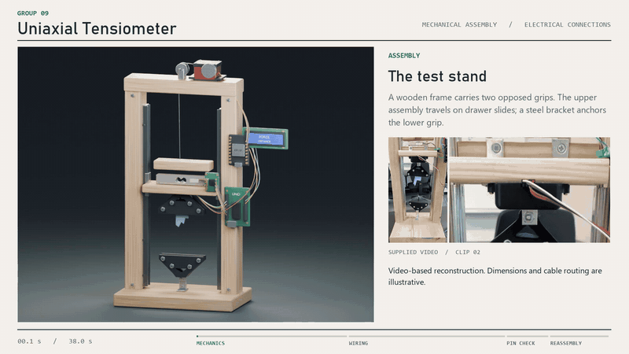
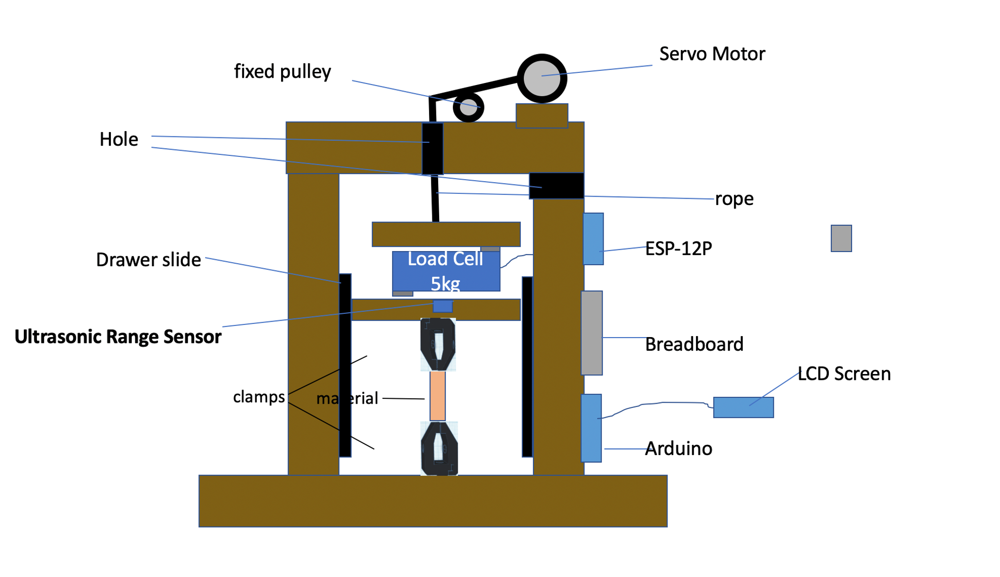

# Group 9 Uniaxial Tensiometer

An ECE 442 team project for measuring how glove material stretches under load. A servo pulls the specimen through a clamped test fixture. A load cell and HX711 amplifier measure the applied load, an ultrasonic sensor tracks distance, and an Arduino displays readings on an LCD. An ESP8266 running Blynk provides phone control of the servo.

## Assembly and wiring animation

[Watch the full-resolution MP4](media/tensiometer-assembly.mp4) · [Download the editable Blender scene](models/tensiometer-assembly.blend)

The 38-second animation follows the load path from the specimen grips to the load cell, then traces the sensor, display and servo connections. The wiring follows Figure 2 of the [physical design report](docs/reports/02-physical-design.pdf). A pin comparison near the end shows where the figure, report text and archived sketch disagree. The project videos show the mechanical layout but do not resolve the pin assignments.

## Prototype demonstration

[Watch the physical tensiometer in action (32-second MP4 with original audio).](media/tensiometer-prototype-demo.mp4)

### Hardware layout

## Repository guide

| To find | Open |
| --- | --- |
| Design requirements, circuit schematic and experimental results | [Reports](docs/reports/) |
| Final slides and project poster | [Presentations](docs/presentations/) |
| Arduino, ESP-12F and MATLAB code as submitted | [Code listings](docs/code-listings/) |
| Printable clamp and editable Blender assembly | [Models](models/) |
| Assembly animation and prototype demonstration | [Media](media/) |
| Calibration data, trial recordings and editable sampling sketch | [Supplement](supplement/) |

## Reference tester design

The [supporting information for *Fabrication of an Economical Arduino-Based Uniaxial Tensile Tester*](docs/references/arduino-tensile-tester-supporting-information.pdf) covers the parts list, assembly, wiring and sample clamps.

Compare the [reference clamp model (STL)](models/reference/mechanical-tester-clamps.stl) with the [clamp model archived by Group 9 (STL)](models/clamp.stl).

## Final experiments

The team tested one latex specimen and one nitrile specimen. Young’s modulus comes from the slope of the elastic region of the stress–strain curve. Ultimate tensile strength is the peak engineering stress. The values below come from Table 1 of the [final experimental report](docs/reports/03-experimental-results.pdf).

| Specimen | Trials | Young’s modulus | Ultimate tensile strength |
| --- | ---: | ---: | ---: |
| Latex glove | 1 | 864 kPa | 3.74 MPa |
| Nitrile glove | 1 | 2.03 MPa | 3.80 MPa |

The [MATLAB listing](docs/code-listings/matlab.pdf) reads `data2.xlsx`. That exact input workbook is missing from the archive. The development workbook below has different labels and does not establish which rows produced these final results.

## Recheck the early nitrile result

The [161-sample baseline recording](supplement/experiments/baseline/nitrile_baseline_mm.csv) has two headerless columns, force in newtons and sensor distance in millimetres. The original specimen was 20 mm wide and 0.0762 mm thick. Its initial cross-sectional area was 1.524 mm². Dividing the peak force of 19.4 N by that area gives **12.73 MPa**, the tensile strength reported for the early prototype. The elastic region was too indistinct to estimate Young’s modulus from that run.

| Supplement | What it adds |
| --- | --- |
| [Second baseline recording](supplement/experiments/baseline/force_distance_cm.csv) | 314 force–distance pairs. This file uses **centimetres** and has no recorded specimen identity. |
| [Ultrasonic calibration](supplement/calibration/ultrasonic_distance.csv) · [Load-cell calibration](supplement/calibration/load_cell.csv) | Seven reference distances and 16 reference masses, with the original units in the column headers. |
| [Development workbook](supplement/experiments/development/blue_white_trials.xlsx) | Two charts with their formulas. The blue series uses rows 3–23 (X = I, Y = H). The white series uses rows 29–62 (X = H, Y = I). The source identifies the samples by colour only. |
| [Proposed parts and costs](supplement/design/proposed_parts.csv) | Four early estimates in USD, including a winch considered during design. The final build used a servo. |
| [Sampling sketch](supplement/firmware/control_and_sampling/control_and_sampling.ino) | Editable Arduino code for checking the two sensors independently of the motor and phone interface. |

The [Chinese supplement guide](supplement/README.zh-CN.md) records the original filenames, spreadsheet ranges and units for each item.

## Hardware and software

**Clamp.** The team edited the clamp in Tinkercad, exported the STL and sliced it with PrusaSlicer to generate G-code for the printer. The [printable clamp model](models/clamp.stl) is included here. See the [logical design](docs/reports/01-logical-design.pdf) for the requirements and the [physical design](docs/reports/02-physical-design.pdf) for the hardware arrangement. The original parts list links to the [25T servo gear](https://www.amazon.com/dp/B07YWKMQ1M), [LCD](https://www.amazon.com/dp/B07S7PJYM6), [ESP8266 board](https://www.amazon.com/dp/B010O1G1ES) and [servo](https://www.amazon.com/dp/B07Z3VGZNP).

**Sensor check.** Open the sampling sketch in the Arduino IDE and install the [HX711 library](https://github.com/bogde/HX711). In this sketch, HX711 DOUT connects to D4 and SCK to D5. The ultrasonic sensor uses D2 for Echo and D3 for Trig. Open the serial monitor at **9600 baud**. It prints a mean raw load reading, a load column labelled in grams and a median distance in cm. Calibrate the load cell before interpreting the grams column. The sketch ships with slope 1 and offset 0.

**Final firmware.** The [Arduino listing](docs/code-listings/arduino.pdf) documents the calibration sequence and LCD interface. The [ESP-12F listing](docs/code-listings/esp-12f.pdf) shows the Blynk callbacks and servo control. Its Wi-Fi network name, password and Blynk token are redacted. Use your own configuration locally. The original project used the [ESP8266 Wi-Fi library](https://github.com/esp8266/Arduino/tree/master/libraries/ESP8266WiFi) and this [Blynk tutorial](https://www.youtube.com/watch?v=EYrEjC3QEew).

## Presentation materials

The [final presentation](docs/presentations/final-presentation.pptx) and [project poster](docs/presentations/project-poster.pptx) summarize the design and experimental findings.
